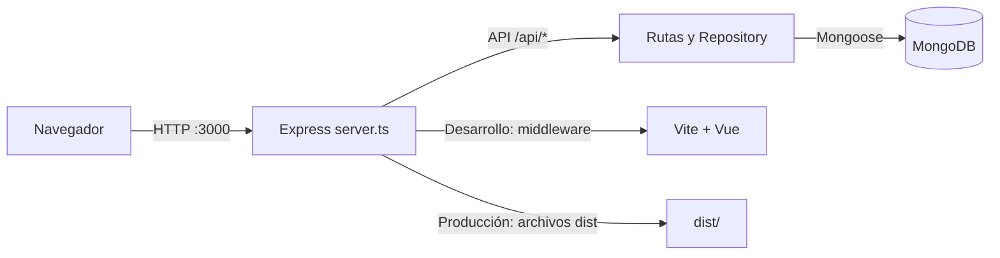

# Manual técnico — SIGCA Centro Armonía

**Sistema Integral de Gestión de Citas y Atención Clínica**  
Versión del manual: 1.0  
Audiencia: desarrollo, soporte y administración técnica

## 1. Objetivo y alcance

Este documento describe la arquitectura, los requisitos, la configuración, los comandos de operación, la persistencia, la API y los controles técnicos de SIGCA. Para el procedimiento orientado al personal de recepción, profesionales y administración, consulta el [Manual de usuario](manual_usuario.md). Para empezar desde una computadora nueva, consulta también el [README](../README.md).

## 2. Arquitectura

SIGCA usa una aplicación integrada: Vue se entrega desde Express y el mismo proceso ofrece la API REST.



### Componentes

- **Frontend:** Vue 3, Vue Router, Pinia, TypeScript y Tailwind CSS 4.
- **Servidor:** Node.js, Express 5 y TypeScript, ejecutado con `tsx`.
- **Persistencia:** MongoDB y Mongoose. `server/data/repository.ts` contiene las operaciones del dominio, sincroniza los registros iniciales en colecciones vacías y carga la información de MongoDB al arrancar.
- **Autenticación:** JWT y contraseñas con hash bcrypt.
- **Docker:** Compose ejecuta `mongo:8.0` y la aplicación Node 20 en servicios separados.

En desarrollo (`NODE_ENV` distinto de `production`), Express monta Vite en modo middleware. En producción, Express sirve los archivos estáticos de `dist/`. No hay un servidor de frontend independiente en esta arquitectura.

## 3. Requisitos

### Ejecución recomendada con Docker

- Git para clonar el repositorio.
- Docker Desktop con Docker Compose en macOS o Windows, o Docker Engine y el complemento Compose en Linux.
- Puertos locales disponibles: `3000` para la web y `27017` para el puerto publicado de MongoDB, salvo que se cambien en `.env`.

Con Docker no es necesario instalar Node.js ni MongoDB localmente. Las instrucciones de instalación y ejecución están en el [README](../README.md#instrucciones-de-instalación-y-ejecución).

### Desarrollo local de la aplicación

- Node.js 20 o superior y npm.
- MongoDB local o el servicio MongoDB de Compose publicado en el host.
- Una variable `JWT_SECRET` de al menos 32 caracteres.

## 4. Configuración de entorno

1. Crear `.env` a partir de `.env.example`.
2. Definir `JWT_SECRET` con una cadena aleatoria de al menos 32 caracteres.
3. Verificar que los puertos configurados estén disponibles.

| Variable | Uso |
|---|---|
| `JWT_SECRET` | Clave para firmar y verificar tokens. Es obligatoria y el servidor valida una longitud mínima de 32 caracteres. No se debe registrar en logs ni compartir. |
| `PORT` | Puerto publicado en el host por Compose; por defecto, `3000`. El servidor del contenedor escucha internamente en `3000`. |
| `MONGO_PORT` | Puerto del host publicado para MongoDB; por defecto, `27017`. Dentro de Compose MongoDB escucha en `27017`. |
| `MONGODB_URI` | URI usada por ejecución local (`npm run dev` o `npm run seed`). El valor de Compose para la app se fija en `mongodb://mongo:27017/sigca_armonia`. |

Compose publica los puertos en `127.0.0.1`, así que los servicios se exponen localmente y no en todas las interfaces de red. Para Docker, el servicio `app` recibe `MONGODB_URI` con el nombre DNS `mongo`; no se debe cambiar por `localhost` dentro del contenedor.

Las demás variables del archivo de ejemplo pueden corresponder a configuraciones planeadas o de otras modalidades. Revisa `compose.yaml` y las referencias `process.env` del código antes de asumir que Compose las consume.

## 5. Instalación, desarrollo y operación

### Levantar todos los servicios con Docker

Desde la raíz del repositorio, con Docker Desktop o Docker Engine iniciado:

```bash
docker compose -f compose.yaml up --build -d
docker compose -f compose.yaml ps
```

La aplicación compila el frontend en la etapa `builder`; la etapa `runner` ejecuta `server.ts` en `NODE_ENV=production`. La base de datos usa el volumen persistente `mongo_data`. La app espera a que el healthcheck de MongoDB esté saludable antes de iniciar.

Comprobaciones:

- Mongo debe aparecer `healthy` en `docker compose ps`.
- La aplicación debe permanecer `Up` y sus logs deben mostrar la conexión con MongoDB y que el servidor está escuchando.
- `http://localhost:3000/api/health` debe responder JSON con `status: ok`.

### Logs y ciclo de vida

```bash
# Logs de la aplicación
docker compose -f compose.yaml logs --tail=100 app

# Seguir los logs en tiempo real
docker compose -f compose.yaml logs -f app

# Detener y eliminar contenedores/red, conservando el volumen de datos
docker compose -f compose.yaml down

# Volver a iniciar los servicios existentes
docker compose -f compose.yaml up -d
```

No uses `docker compose down -v` para una parada normal: `-v` elimina el volumen de MongoDB y los datos persistidos.

### Desarrollo local del servidor

Para ejecutar Vite como middleware y el servidor con recarga de desarrollo:

```bash
npm ci
npm run dev
```

En esta modalidad `MONGODB_URI` debe apuntar al host. Si MongoDB se publica en un puerto diferente, por ejemplo `27018`, actualiza la URI local a `mongodb://127.0.0.1:27018/sigca_armonia`. `npm run dev` ocupa el puerto `3000`; no lo ejecutes a la vez que el servicio `app` de Compose.

### Build, lint y pruebas

```bash
npm run build
npm run lint
npm test
```

- `npm run build`: verifica TypeScript de Vue y servidor y crea los recursos web en `dist/`.
- `npm run lint`: ejecuta `vue-tsc --noEmit` para el frontend.
- `npm test`: ejecuta `scripts/test-api.ts`.

## 6. Estructura relevante del proyecto

```text
.
├── src/
│   ├── components/       # Componentes compartidos y administrativos
│   ├── stores/           # Estado de la aplicación y operaciones API
│   ├── views/admin/      # Vistas de operación interna
│   ├── views/public/     # Portal público
│   └── router/           # Rutas y guards por rol
├── server.ts             # Arranque Express, API, Vite/estáticos y healthcheck
├── server/
│   ├── config/db.ts       # Conexión Mongoose
│   ├── data/              # Repository y datos iniciales
│   ├── middleware/        # JWT y autorización
│   ├── models/             # Esquemas Mongoose
│   └── routes/             # Endpoints REST
├── scripts/seed.ts         # Carga manual de fixtures
├── compose.yaml            # App y MongoDB
├── Dockerfile              # Build multi-stage Node 20
└── docs/                   # Manuales y material de diseño
```

## 7. Arranque, datos iniciales y persistencia

`server.ts` carga `.env`, valida `JWT_SECRET`, conecta con MongoDB, sincroniza los datos de demostración cuando las colecciones están vacías y después registra las rutas. Si MongoDB no está disponible, el servidor sale con error; no funciona con una base temporal en memoria.

`scripts/seed.ts` también carga fixtures únicamente en colecciones vacías:

```bash
npm run seed
```

El script lee `MONGODB_URI` del entorno local. `SEED_RESET=true` elimina las colecciones SIGCA antes de insertar de nuevo las fixtures. Esta operación destruye la información existente y solo debe usarse cuando se desea reiniciar intencionalmente una base de pruebas.

En Docker, MongoDB almacena sus archivos en el volumen `mongo_data`. Eliminar o recrear contenedores sin la opción `-v` conserva ese volumen.

## 8. API REST

La base de la API es `/api`. La mayoría de las respuestas usa la forma `{ success, data, message }`; las listas también incluyen `count`. El middleware global habilita CORS y analiza JSON con un límite de 2 MB. Las rutas no reconocidas bajo `/api` devuelven un 404 JSON.

### Autenticación

- `POST /api/auth/login`: correo y contraseña; devuelve un JWT y datos públicos del usuario.
- `GET /api/auth/me`: devuelve el usuario autenticado.
- `PATCH /api/auth/me/avatar`: actualiza el avatar del usuario autenticado.
- Enviar el token en `Authorization: Bearer <token>` para rutas privadas.

El token expira en 24 horas. Cada solicitud privada vuelve a validar que el usuario exista y siga activo.

### Grupos de rutas

| Base | Funciones | Acceso principal |
|---|---|---|
| `/api/health` | Estado de proceso | Público |
| `/api/servicios` | Consulta pública; alta, edición y estado | Consulta pública; mutaciones ADMIN |
| `/api/contenido`, `/api/horarios` | Consulta pública y edición institucional | Lectura pública; cambios ADMIN |
| `/api/solicitudes-cita` | Crear solicitud pública, listar, cambiar estado y convertir en cita | Crear público; gestión ADMIN/RECEPCION |
| `/api/contacto` | Enviar mensaje público, listar y marcar leído | Crear público; gestión ADMIN/RECEPCION en API |
| `/api/usuarios` | Directorio y gestión de cuentas | Directorio autenticado; administración ADMIN |
| `/api/pacientes` | Listar, consultar, registrar, editar y cambiar estado | Lectura autenticada; escritura ADMIN/RECEPCION; PROFESIONAL limitado a pacientes asignados |
| `/api/responsables` | Consultar, registrar y editar responsables | Lectura autenticada limitada por agenda; escritura ADMIN/RECEPCION |
| `/api/citas` | Disponibilidad, consulta, crear, reprogramar, cambiar estado y consultar saldo/pagos | Lectura autenticada; alta/reprogramación ADMIN/RECEPCION; PROFESIONAL solo consulta las propias y puede completarlas |
| `/api/materiales` | Consultar, crear, editar y asignar material | Lectura autenticada; crear/editar ADMIN; asignar ADMIN/PROFESIONAL |
| `/api/pagos` | Consultar, registrar y anular pagos | ADMIN/RECEPCION; eliminación física bloqueada |
| `/api/cajas` | Abrir, consultar, listar movimientos y cerrar caja | ADMIN/RECEPCION; límites de propiedad para RECEPCION |
| `/api/reportes/dashboard` | Métricas administrativas y financieras | ADMIN/RECEPCION |

Las reglas se implementan en los routers, el middleware y el Repository. La interfaz Vue agrega guards de navegación, pero los permisos críticos también se verifican en la API.

### Contrato y reglas importantes

- Los roles internos son `ADMIN`, `RECEPCION` y `PROFESIONAL`.
- Los estados de cita son `PENDIENTE`, `CONFIRMADA`, `COMPLETADA` y `CANCELADA`.
- El profesional solo puede completar citas que estén asignadas a su usuario.
- Las citas completadas no se reprograman; las canceladas/completadas respetan sus restricciones de estado.
- Los menores requieren al menos un responsable para programar.
- Se rechazan conflictos de horario y citas en el pasado.
- Los pagos deben ser positivos, estar relacionados con una cita y no superar su saldo. Para recibir pagos debe existir caja abierta del usuario.
- Los pagos se anulan con motivo y auditoría; no se eliminan físicamente.
- Las fotos de paciente, responsable y usuario aceptan JPG, PNG o WebP en base64, con límite aproximado de 600 KB por imagen.

## 9. Modelos y persistencia

Los modelos Mongoose se encuentran en `server/models/`:

| Modelo | Propósito |
|---|---|
| `User` | Cuentas, roles, estado y credenciales hasheadas |
| `Patient`, `Guardian` | Expedientes de pacientes y responsables asociados |
| `Service`, `Schedule` | Catálogo clínico y horarios de atención |
| `Appointment`, `Request` | Agenda y solicitudes públicas |
| `Payment`, `CashRegister`, `Counter` | Cobros, arqueo, movimientos y correlativos |
| `Material`, `MaterialAssignment` | Recursos educativos y asignaciones |
| `Content`, `InstitutionalContent`, `ContactMessage` | Contenido y contacto del portal |

El Repository mantiene estructuras de dominio para atender las operaciones del proceso y sincroniza los cambios con MongoDB. Debe tratarse MongoDB como fuente persistente: reiniciar o reemplazar el contenedor `app` no borra los datos guardados en el volumen de `mongo_data`.

## 10. Seguridad y datos

- Define una `JWT_SECRET` aleatoria y privada; no uses una clave compartida o del repositorio.
- No publiques `.env`, tokens, contraseñas, datos clínicos o recibos con información personal.
- Las contraseñas se almacenan con bcrypt; nunca se devuelven hashes en el login.
- Un usuario inactivo no puede iniciar sesión y los tokens existentes se rechazan cuando el servidor vuelve a verificar su estado.
- MongoDB de Compose no tiene autenticación configurada y sus puertos solo se publican en loopback. Esta configuración es para demostración local, no constituye un despliegue público endurecido.
- Las credenciales de fixtures en `initialData.ts` son conocidas y solo sirven para demostraciones. Cambia o elimina esos usuarios antes de usar información real.

## 11. Diagnóstico

| Síntoma | Revisión y acción |
|---|---|
| Docker no puede conectar con el daemon o `docker.sock` | Inicia Docker Desktop o el servicio de Docker y verifica `docker compose version`. |
| Puerto `27017` ocupado | Cambia `MONGO_PORT` en `.env`, por ejemplo a `27018`, y vuelve a crear el servicio. No cambies `mongodb://mongo:27017/...` dentro de Compose: es la dirección interna de red. |
| Puerto `3000` ocupado | Cambia `PORT` para publicar la app en otro puerto del host, por ejemplo `3001`. |
| `ENOTFOUND mongo` en logs de app | Revisa `docker compose ps`. Recrea la red y contenedores con `docker compose -f compose.yaml down` y `docker compose -f compose.yaml up --build -d`. No añadas `-v`, para conservar datos. |
| App aparece `Up` pero la web no responde | `Up` no es una comprobación de salud de la app. Revisa `docker compose logs --tail=100 app` y confirma que el log muestre conexión a Mongo y el servidor escuchando. Luego consulta `/api/health`. |
| La sesión se pierde o el token expira | Vuelve a iniciar sesión; los tokens tienen duración de 24 horas. |
| Un usuario profesional no ve un paciente | Confirma que tenga una cita asignada con ese paciente; el alcance de lectura está limitado a su agenda. |

## 12. Mantenimiento

- Usa `compose.yaml` como archivo Compose principal y pasa `-f compose.yaml` para evitar ambigüedad con `docker-compose.yml`.
- Reconstruye la imagen después de cambiar código del servidor o frontend: `docker compose -f compose.yaml up --build -d`.
- Antes de cambios importantes en una instalación con datos reales, realiza una copia de seguridad de MongoDB por el procedimiento operativo aprobado para ese entorno.
- No ejecutes `SEED_RESET=true` ni `docker compose down -v` como comandos rutinarios.
- Conserva la colección Postman `SIGCA-Centro-Armonia.postman_collection.json` para pruebas manuales de endpoints y actualízala si cambia el contrato.
